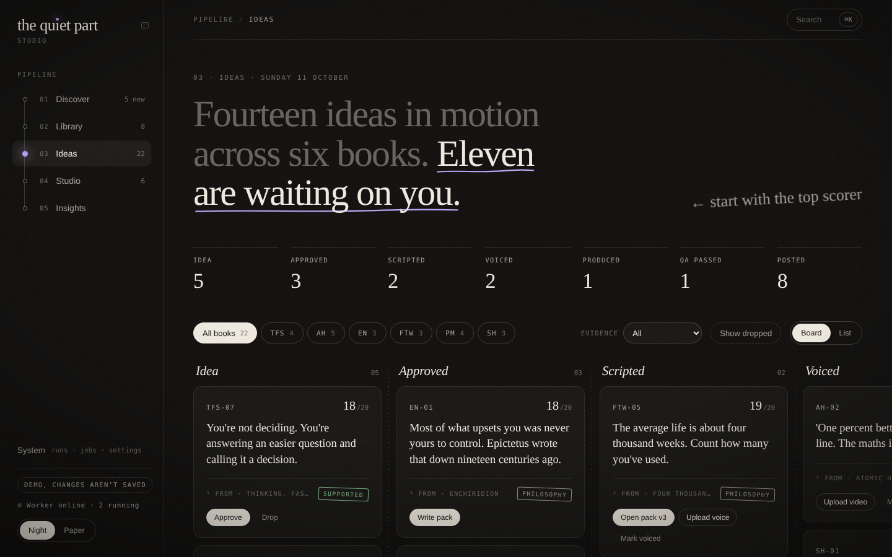
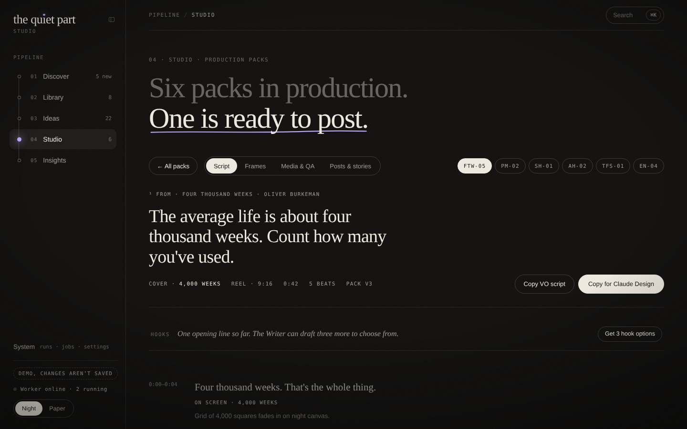
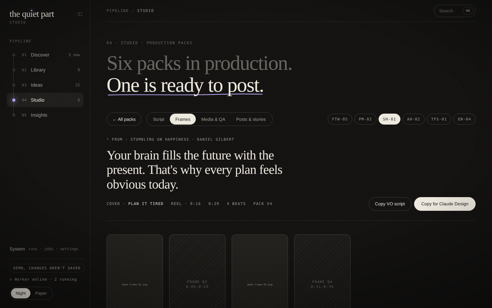
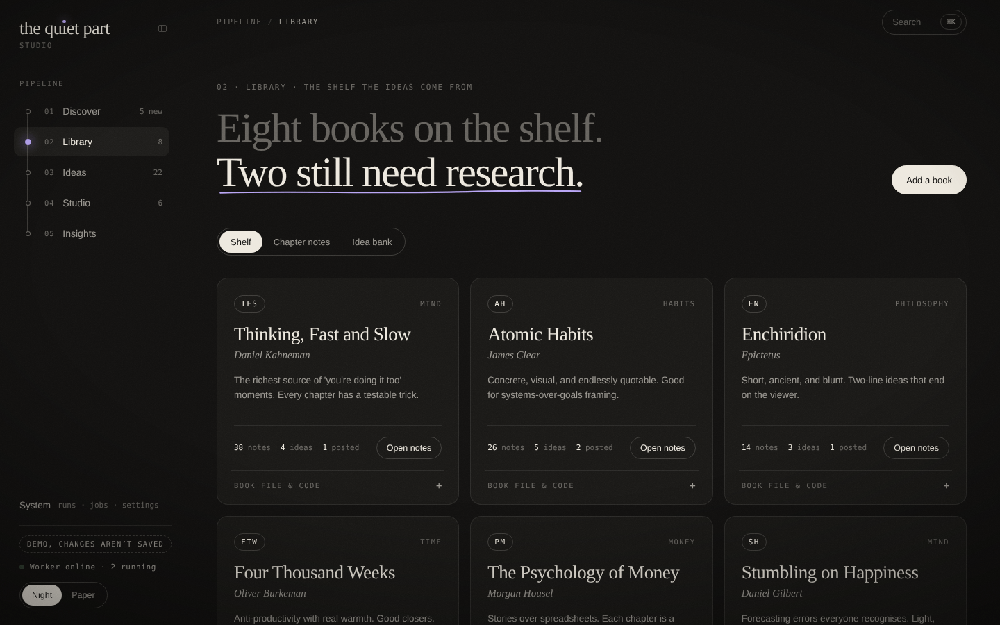
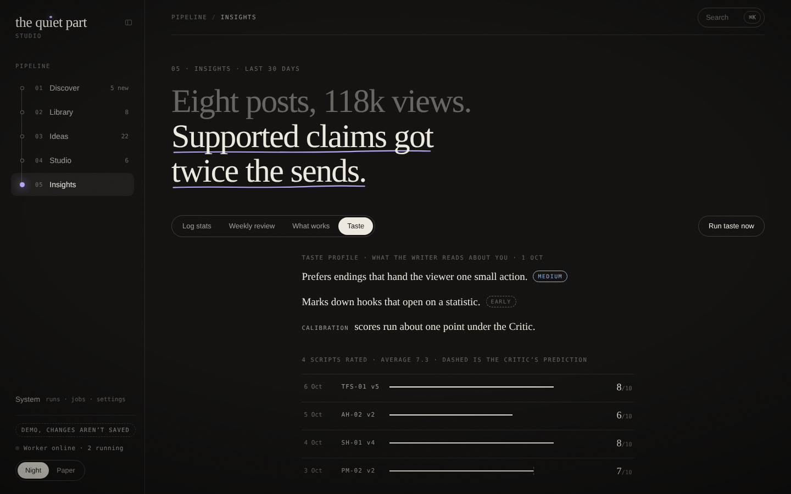
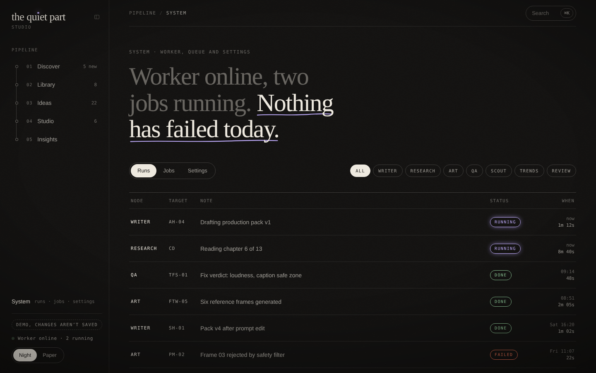
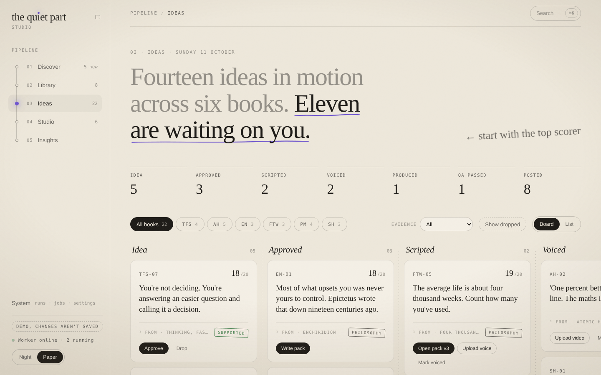
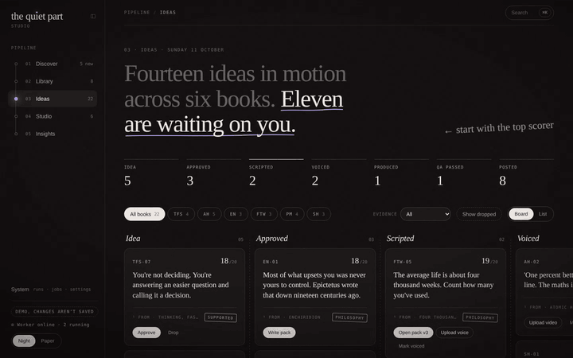
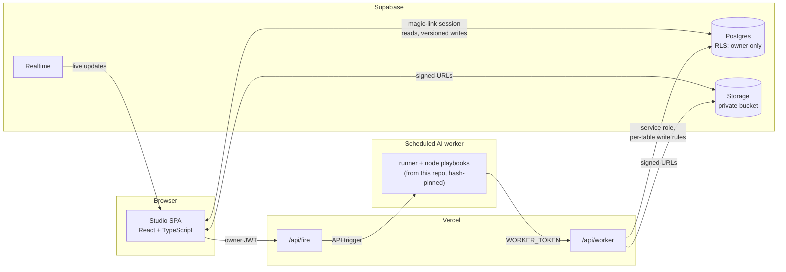

# the quiet part · Studio

A private production studio for **the.quiet_part**, a faceless Instagram brand that turns ideas from books into short, calm, evidence-checked reels.

One owner uses it to run the whole pipeline: find books, read them into chapter notes and an idea bank, move ideas across a board, write script packs, make reference frames, check finished videos, and learn from how posted reels perform. The heavy lifting (reading, writing, checking) is done by an AI worker that runs on a schedule and picks jobs off a queue; the studio is where the owner decides.

**Live demo:** https://harsh-raj-08.github.io/quiet-part-studio/
The demo runs entirely in the browser on invented data. Nothing is saved and it never talks to a server.



## What's in it

| | |
|---|---|
| **Ideas** | A board (or list) with the pipeline stages Idea → Approved → Scripted → Voiced → Produced → QA passed → Posted. Drag and drop, keyboard moves, filters by book and evidence. |
| **Studio** | Script packs: beats with voiceover, on-screen text and a visual note for each; hooks; caption; Critic scores. Edits create new versions. Frames, media and QA reports, posts and stories. |
| **Library** | Book shelf with uploads and research runs, chapter notes, and the idea bank. |
| **Discover** | Ask a scout about books, scout reports and trend reports. |
| **Insights** | Logged stats per reel, weekly reviews, what works, and the taste profile. |
| **System** | Jobs and runs, worker status, settings, playbooks. |

| Studio · script | Studio · frames |
|---|---|
|  |  |
| **Library** | **Insights · taste** |
|  |  |
| **System** | **Paper theme** |
|  |  |

The navigation folds from a sidebar into a command bar (Ctrl/⌘ + \\), keeping your place on the page:



## How it works



- **Everything is a job.** No AI runs in the page. A button such as "Write pack", "Get 3 hook options" or "Run QA" writes a job document and asks `/api/fire` to start the worker. The page shows the job's progress live and the result when the worker writes it.
- **The worker** follows `playbooks/runner.md` and one playbook per node (scout, trends, research, writer, critic, art, qa, review, taste). It reaches the data only through `/api/worker`, which checks every write against per-table rules. On Mondays the server queues the weekly scout, trends and review runs.
- **Data** lives in Supabase as small JSON documents with a version number. Every write is a versioned update through one database function, so two tabs (or the owner and the worker) never silently overwrite each other.

More detail: [docs/ARCHITECTURE.md](docs/ARCHITECTURE.md).

## The taste loop

The writer gets better at the owner's taste over time, and the owner stays in control of what it learns:

1. The owner rates each script 1–10 with a one-line note.
2. Every fifth rating queues the **Taste** node. It reads the ratings and proposes a short taste profile, each line marked early / medium / strong with the ratings behind it.
3. The owner reads the proposal in Insights and accepts it (or not). Only an accepted profile is used.
4. The **Writer** reads the accepted taste profile and a few gold scripts (the owner's highest-rated packs) for their shape, never their words.
5. A **Critic** pass scores each draft and predicts the owner's score; the gap between prediction and rating is tracked as calibration.

## Security

Single owner, least privilege:

- Row-level security on every table and on the storage bucket: only the user listed in `studio_owner` can read or write. Magic-link sign-in with sign-ups turned off.
- The worker has its own token and a narrow API: per-table and per-field write rules, append-only history and metrics, no deletes, no access to ratings or to the owner's own fields.
- Files stay in a private bucket; the browser and the worker only get short-lived signed URLs.
- Strict Content-Security-Policy and security headers; the build refuses to bundle anything but the public key.

Threat model, residual risks and token rotation: [docs/SECURITY.md](docs/SECURITY.md).

## Tech

React 19 and TypeScript, bundled with esbuild (ES modules, one lazily loaded chunk per screen). Supabase (Postgres, RLS, Realtime, Storage, magic-link auth). Vercel serverless functions. Tests with `node:test` and Playwright. No UI framework: the design system is a small set of tokens and components in `src/design`.

## Run it locally

Demo mode needs no keys or accounts:

```sh
npm install
STUDIO_MODE=demo npm run build
npx serve dist        # or any static server
```

Tests (unit tests plus the Playwright suite against a mock-mode build, pinned to Asia/Kolkata):

```sh
npx playwright install chromium
npm test
```

CI runs typecheck, build and the full suite on every push. A second workflow builds the demo and publishes it to GitHub Pages.

To run your own studio (Supabase, Vercel and the scheduled worker), follow [docs/SETUP.md](docs/SETUP.md).

README screenshots come from the demo build: `node scripts/capture-readme.mjs`.

## License

[MIT](LICENSE)
